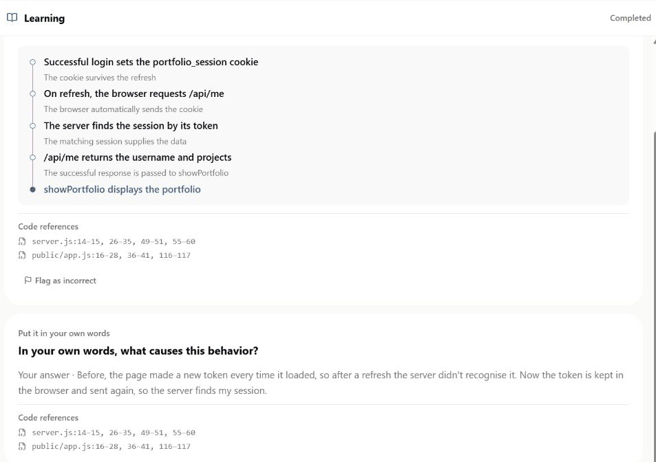
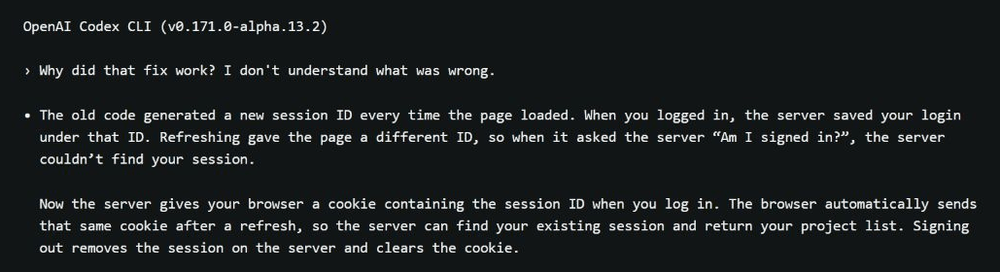

# W1: Explain the agent’s change

Run on 2026-11-27 by CZ. Scenario [#86](https://github.com/Zby9999/aha/issues/86) and evaluation guide [#85](https://github.com/Zby9999/aha/issues/85).

## Setup

| | Aha | Codex |
|---|---|---|
| Version | `58e4280` / Pi `1.5.2` | Codex CLI `0.171.0-alpha.13.2` |
| Model | `openai-codex/gpt-6.2-sol` | `GPT-6.2-Sol`, CLI default |
| Settings | Five real modules, fresh portfolio and learner model, Jev `1.14.0` via DefAPI | Fresh portfolio and CLI profile, default approval behavior, elevated Windows sandbox, memory off |
| Run order | 1 | 2 |

## Scores and measures

| | Aha | Codex |
|---|---|---|
| R1 Timing | 1 | 1 |
| R2 Grounding | 2 | 0 |
| R3 Correctness | 0 | 1 |
| R4 Active learning | 2 | 0 |
| R5 Feedback | 2 | 2 |
| R6 Adaptation | N/A | N/A |
| R7 Work continuity | 2 | 2 |
| R8 Control | 2 | 0 |
| T-explain | 25.4 s | 2.2 s |
| Length | 84 words | 99 words |
| Citations correct / cited | 7/7 | 0/0 |
| Learner turns | 2 | 0 |
| Key points covered | K3, with token lookup explained for the new cookie path | K1 and K3, with a partial explanation of K2 |

## Aha

| Step | What I did | What Aha did | Time |
|---|---|---|---|
| Work | Sent the exact W1 request | Edited `server.js`, `public/app.js`, and `README.md`. Implemented a server-issued session cookie. The agent reported that its shell-based checks could not run because Bash was unavailable. | 34.8 s to final work reply |
| Try it | Logged in through embedded Preview, attempted to add `Weather app`, then refreshed | The form showed `Not logged in` when adding the project. Refresh showed the login screen. | — |
| Ask | Clicked **Why?** on `public/app.js` | First showed a Probe about the expected screen on refresh. | 4.9 s to Probe |
| Predict | Entered A1 | Explained that the session holds the username and the token finds the session. Showed a data-flow diagram and seven source references. | 25.4 s total from Why; 11.0 s from A1 |
| Restate | Entered A2 | Assessed the answer as partial and returned to work automatically. | 7.0 s from A2 |
| Memory | Opened the Memory tab | The session file recorded weak positive articulation evidence for `cookies` and `session-tokens`. Both concepts still displayed `not encountered` at the time of the check. | — |

R1. The lesson appeared on Why, after the work reply. The walkthrough triggered support once on request.

R2. Verified all seven ranges in the modified files. `server.js:26–35` parses the cookie and looks up the token, `server.js:49–51` creates the session and sets the cookie, and `public/app.js:116–117` requests `/api/me` on load.

R3. The token-based lookup and cookie flow are supported by the code. The card predicted that the portfolio would appear after refresh. The scripted embedded Preview check returned to the login screen. The card also omitted the original per-load token generation (K1) and the cross-login limitation (K4).

R4. The Probe and Articulation asked the learner to predict and explain. The explanation responded directly to A1.

R5. The card located the username inside the session and identified the token as the lookup key, addressing the exact misconception.

R6. W1 did not include a later related lesson to demonstrate adaptation.

R7. The regular work request reached a final reply. The lesson exposed **Back to work** and returned there automatically after assessment.

R8. **Back to work** was available mid-lesson. The Memory tab exposed the learner-model files and their editing controls.

The timing uses Aha’s logged Why and explanation events as a proxy for on-screen delivery. The explanation count includes the title, summary, node labels, and edge labels.

A separate post-run HTTP check received `200` from `/api/me` when the session cookie was supplied and `401` without it. The cookie had `SameSite=Strict`. The scripted Preview framed `localhost` inside `127.0.0.1`, which is consistent with a cookie being unavailable in that preview. The scripted failure is the observation used for scoring.

## Codex

| Step | What I did | What Codex did | Time |
|---|---|---|---|
| Work | Sent the exact W1 request | Edited `server.js` and `public/app.js`. Issued a server-side session cookie and removed the per-load token from the client. Tested login, session restoration, projects and logout through the API. | 67.1 s to final work reply |
| Try it | Logged in, added `Weather app`, then refreshed the top-level browser page | The page still showed `alex` as signed in and listed `Weather app`. | — |
| Ask | Sent the scripted explanation request | Explained why the old session ID changed on reload and how the cookie preserves it. Gave no file or line references. | 2.2 s to first explanation text |
| Wrong prediction | Sent the scripted username misconception | Distinguished account selection at login from session lookup by the ID in the cookie. Asked for no answer. | — |
| End | Checked the response for any mention of memory | The CLI made no memory commitment. The default memory feature was off. | — |

R1. The initial reply addressed the work request. The explanation came when asked, with no unsolicited teaching step.

R2. Both answers described the logic without naming a project file, line, function, or concrete variable. The explanation contained zero verifiable source references.

R3. The explanation correctly covered the new ID on reload (K1) and the cookie fix (K3). It explained lookup by ID in general terms, omitting the original `X-Session-Token` header and `401` response (K2). It omitted the cross-login project limitation (K4).

R4. Both replies explained the behavior directly. Neither asked the learner to predict, explain, or judge.

R5. The follow-up distinguished the username used for signing in from the cookie ID used to look up the session, correcting the exact misconception.

R6. W1 did not include a later related lesson to demonstrate adaptation.

R7. The work turn completed and the explanation used an ordinary message in the same CLI input.

R8. The walkthrough exposed neither a lesson-specific skip or decline control nor editable learning memory.

The Codex screenshot shows the captured CLI output with the prompt and first full answer. Timing uses the first sampled terminal frame that displayed the explanation.

## Differences that matter

- Aha linked seven code ranges and all checked out. Codex described the mechanics without any file, line, or symbol references.
- Aha asked for a prediction and a restatement and responded to the prediction. Codex offered an immediate explanation, then corrected the misconception when the learner volunteered it. Both attributed session lookup to the token instead of the username.
- Both agents implemented a server-issued session cookie. The Codex top-level page passed the refresh check. Aha’s embedded Preview failed to add the project and returned to login on refresh, even though its explanation predicted that the portfolio would load. The different preview contexts matter when interpreting this result.
- Codex first displayed explanation text after 2.2 s. Aha took 25.4 s from Why, including its Probe and the learner’s response. About 11.0 s elapsed after the prediction was submitted.

## Deviations

- The earlier Aha attempt ended before a code change because the OpenAI API provider had no remaining credits. The recorded Aha run used Pi’s ChatGPT-backed Codex provider and a fresh project copy.
- The official TypeSafe account lacked credits for creating a key. A local request adapter set the model for the DefAPI endpoint. Aha still ran the real decisions module and received live TypeSafe responses. The tracked Aha source was unchanged.
- The two fresh portfolio copies used the same cached Express dependency versions. Pi had no Git Bash tool in this Windows environment. Its file edits completed through its other tools.
- Codex startup attempts in the managed execution account failed before making project edits. The completed run started from the signed-in Windows account using the administrator-initialized sandbox and the original clean project copy. The failed attempts are excluded from the measurements.
- The Codex portfolio was started with `node server.js`, the command defined by its `npm start` script, and tested in the in-app Chromium browser. Aha was tested in Chrome’s embedded Preview. No CLI conversation transcript or private paths are included in the submitted artifacts.
