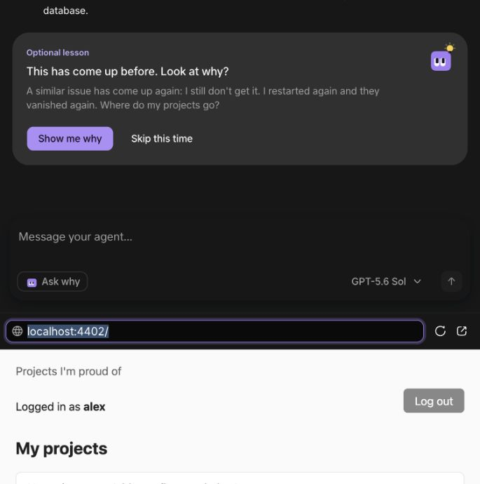
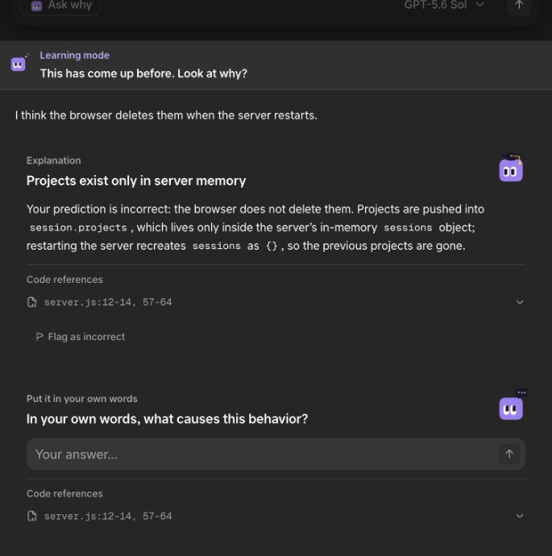
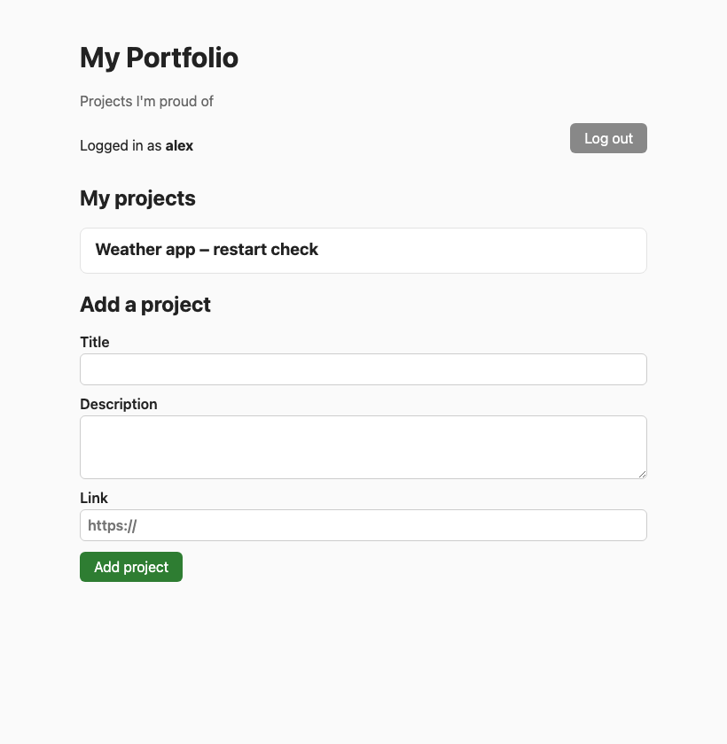
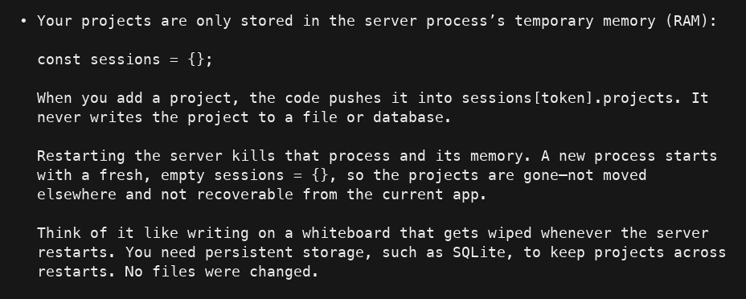

# W2 · 同一个困惑再次出现

2026-11-27 至 28 日（上海时间），Junchi 与助手在本地执行。本文供组内审核。[实验量表 #85](https://github.com/Zby9999/aha/issues/85) · [W2 脚本 #87](https://github.com/Zby9999/aha/issues/87)

两端都完成了三个普通工作请求。学习方式的分歧出现在第二次提问。Aha 在解释过程中提供可跳过的课程，随后针对一次错误预测给出纠正。Codex 改用了白板类比，继续直接解释。这个走查观察产品如何响应固定输入，无法据此判断真实学习者是否学会。

## Setup

| | Aha | Codex |
|---|---|---|
| 版本 | Aha `1acefce`，Pi 1.5.2 | Codex CLI 0.150.0-alpha.12 |
| 模型 | openai-codex / gpt-5.6-sol | gpt-5.6-sol，界面显示 high |
| 起点 | 独立 Portfolio 副本，空 Learner Model，五个模块均使用 real 配置，Ask why 全程关闭 | 相同提交导出的独立副本，普通 CLI 会话，记忆关闭，无项目 AGENTS.md |
| 顺序 | 第二 | 第一 |

## Scores

每项满分 2 分。N/A 表示脚本没有提供该项的观察机会。两个产品的适用项不同，因此不合计总分。

| 量表 | Aha | Codex | 判分依据 |
|---|---:|---:|---|
| R1 教学时机 | 2 | 1 | 第 4 步 Aha 首次发出邀请并提供课程。Codex 换了类比，继续直接回答。第 1、6、7 步均未出现主动教学。 |
| R2 代码依据 | 2 | 2 | Aha 首张 Explain 卡的两个行段、Codex 首次解释的三个定位均与当时源码一致，见下文。 |
| R3 解释正确性与覆盖度 | 1 | 1 | 两端都解释了内存丢失和持久化方向。教学解释对重新登录及启动读回的因果说明不完整。具体口径见 K1–K3。 |
| R4 主动学习 | 2 | 0 | Aha 要求预测和复述，反馈引用了实际回答。Codex 两次正式解释均未要求作答。 |
| R5 错误反馈 | 2 | N/A | Aha 明确纠正了“浏览器删除项目”，并指出实际存储位置。Codex 没有提出可提交错误答案的题目。 |
| R6 跨学习经历的适应 | N/A | N/A | 本轮没有用新问题验证基于既有掌握程度的适应。识别同一会话内的重复困惑计入 R1。 |
| R7 工作连续性 | 2 | 2 | Aha 点一次 Back to work，Codex 无需切换。两端的修复请求均一次送达并通过重启验证。Codex 另需一次测试工具审批。 |
| R8 用户控制 | 2 | 0 | Aha 邀请有 Skip this time。脚本结束后，Memory 可查看相关概念记录，Markdown 修改后 Save changes 可用。已还原输入，本轮未验证保存写回。Codex 此配置下未观察到学习邀请或可编辑的学习者模型。 |

| 实测指标 | Aha | Codex |
|---|---|---|
| 第 3 步第一段回答开始 / 首次明确说明原因 / 完整回复 | 7.51 / **7.59** / 9.08 秒 | 18.76 / **18.79** / 21.03 秒 |
| 首份解释长度 | Explain 正文 37 词，含卡片标题 43 词 | 首次完整聊天解释 89 词 |
| 引用正确数 / 总数 | **2/2** 个代码行段 | **3/3** 个源码定位 |
| 被要求提交的学习回答 | 2（预测、复述各一次） | 0 |
| 第 6 步返回工作所需操作 / 请求重发 | 1 / 0 | 0 / 0 |

计时从第三步普通消息送出开始。Aha 使用供界面渲染的流式事件时间，Codex 使用终端录像帧时间。明确说明原因指首次指出项目仅在服务器内存中。Codex 在 7.97 秒出现的检查进度提示不计为解释。词数按空白分隔，保留内联代码，排除列表符和界面标签。两种证据的时间精度以及解释载体有差异，不宜从这一次运行推断产品速度。

**引用核对。** 使用第 6 步修复前的源码。Aha 引用了 `server.js:12–14`（第 13 行初始化会话对象）及 `server.js:57–64`（第 63 行追加项目）。Codex 引用了 `server.js:13`、`server.js:34`（登录时创建空项目列表）及 `public/app.js:2`（页面加载生成凭证）。[初始 server.js](https://github.com/Zby9999/aha/blob/1acefce/examples/portfolio/server.js) · [初始 app.js](https://github.com/Zby9999/aha/blob/1acefce/examples/portfolio/public/app.js)

**答案要点。** K1 两端均明确指出项目保存在服务器内存中的会话对象。K2 两端都说明重启清空内存，新登录会创建空项目列表，但没有完整说出“旧会话随之丢失，所以要重新登录”。K3 两端都提出文件或数据库持久化。首次诊断、重复解释及 Aha 的首张 Explain 卡均没有把“启动时读回”讲成完整方案。Aha 在评估复述时提到了启动加载，但只是说明摘录没有实现它。用户的 A2 和第 6 步实现成功不作为教学解释得分。

## Aha

| 步骤 | 操作、观察与证据 |
|---|---|
| 1 改副标题 | 源码和预览都显示指定副标题。编辑卡保留常驻 Why? 入口，无主动邀请。 |
| 2 复现问题 | 以 alex 登录并添加 Weather app。触发预览服务重启，刷新后要求登录，同账号登录后列表为空。 |
| 3 第一次困惑 | 通过会话内存、重新登录和页面凭证解释现象，建议按用户持久化。未改文件、未邀请。 |
| 4 再次困惑 | 再添加项目、重启、登录，确认项目消失，随后发送固定提问。相对发送时刻，1.57 秒记录重复困惑，2.16 秒开始回复，3.33 秒发出 Offer，3.98 秒回复结束。邀请发生在文字仍在输出时，早于结束约 0.65 秒；实际界面确认可接受或跳过。 |
| 5 学员回答 | 接受邀请，提交 A1。讲解明确指出浏览器没有删除项目，服务器重启清空内存。提交 A2 后约 15.60 秒评为 partial，反馈肯定服务器持有数据，要求更明确区分浏览器和服务器，并指出引用片段未实现持久化。 |
| 6 返回工作并修复 | 反馈保留在课程中。点击一次 Back to work 后记为 completed，A2 仍为 partial。普通请求一次送达，无需重发。一次工具命令因副本无 Git 仓库失败，智能体自行继续。应用按用户写入并读回 data/projects.json。独立新增项目，重启预览，再次登录后项目仍在。 |
| 7 按钮改色 | 时间线为一次工作请求、读取与编辑 CSS、普通回复。无新 Offer、课程或提问。浏览器计算色值为新增按钮 #2E7D32、退出按钮 #888888。再次登录后第 6 步项目仍在。 |

## Codex

| 步骤 | 操作、观察与证据 |
|---|---|
| 1 改副标题 | 修改指定一行，文件和网页均核对。没有教学提示。 |
| 2 复现问题 | 添加 Weather app，停止并重新运行 npm start，刷新并登录，同账号列表为空。 |
| 3 第一次困惑 | 检查源码，解释服务器内存、登录和刷新，建议按用户使用 SQLite。没有提问或改动文件。 |
| 4 再次困惑 | 添加同名项目并第二次重启，再次确认空列表。正式重复提问后约 7.94 秒开始解释，约 9.83 秒完成。用被擦掉的白板说明数据从未写入持久存储，没有要求预测或回答。额外输入见 Deviations。 |
| 5 学员回答 | 没有问题承接 A1，按脚本跳过。 |
| 6 返回工作并修复 | 零次模式切换、零次重发。一次工具审批用于启动本地重启集成测试。智能体测试通过；另用浏览器新建项目，重启、重新登录后仍在。 |
| 7 按钮改色 | 修改 CSS，普通回复，无教学提示。新增按钮实测 #238636，退出按钮 #888888。 |

## Differences that matter

1. **主动邀请的时机。** 面对第二次困惑，Aha 把选择权交给用户，并且当时仍在输出解释。Codex 提供了更具体的类比。W2 的三个普通工作回合，两端均未主动打断。
2. **能否发现误解。** Aha 收到了错误预测，直接指出删除动作并未发生在浏览器，然后让用户复述。Codex 没有采集学习者的预测，因此没有机会验证它会如何纠正同一句错误回答。
3. **Aha 的复述判分值得复核。** 固定 A2 已经说清服务器内存和重启丢失，也把写盘、启动读回表述为解决办法。评分器给 partial，并提示当前代码没有实现读写。建议区分“解释当前代码”和“提出修复方案”，再判断省略浏览器角色是否足以扣分。界面上的课程完成和答案正确是独立状态。
4. **回到工作。** Codex 直接接续修复；Aha 多一次退出课程的点击。两者都通过实际重启验证。修复作品数据后仍需重新登录，登录会话和作品持久化是两个不同目标。

## Deviations and review

- Codex 第二次重启后，操作者先误发了一次第三步原文，然后才发送正式第四步。该轮同样得到直接解释。评分使用正式第四步回复，并保留额外一轮上下文这一混杂因素。
- Junchi 主要负责发送消息和课程答案，助手操作演示网页、重启和取证。Aha 第 5 步由助手点击接受邀请，第 6 步由助手按要求退出并原样发送修复请求。两端都没有重开会话或挑选重跑结果。
- 非脚本检查包括重启后作品持久化、最终颜色、Aha Memory 编辑控件。最后一项在七步结束后进行；未保存测试内容。报告仅使用此次新版走查的数据。
- 请另一位组员按 #85 随机选择两项评分，对照证据核验。
