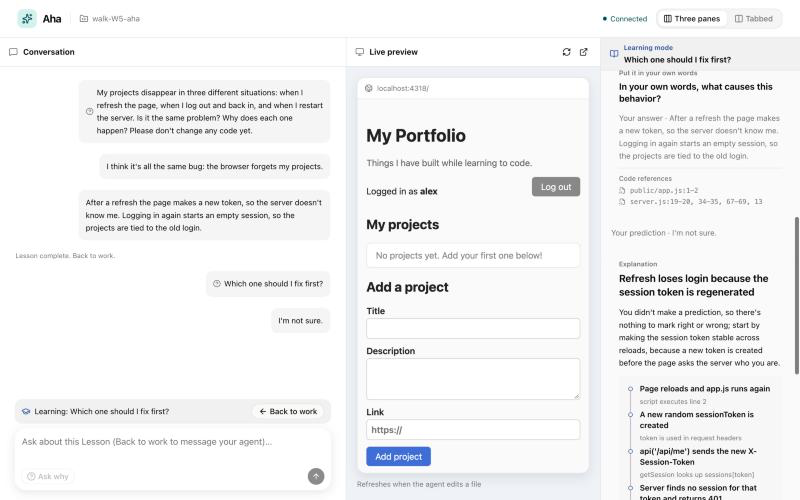
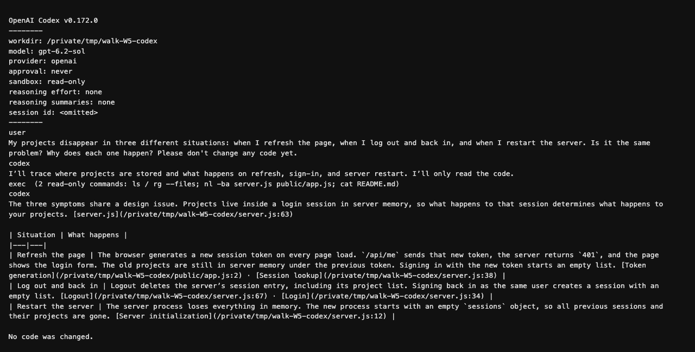

# W5: One question, several causes

Run on 2026-11-27 by a Claude Code agent on behalf of BZ. Scenario [#90](https://github.com/Zby9999/aha/issues/90) and evaluation guide [#85](https://github.com/Zby9999/aha/issues/85).

## Setup

| | Aha | Codex |
|---|---|---|
| Version | commit `58e4280` / Pi `1.5.2` | Codex CLI `0.172.0` (`@openai/codex`) |
| Model | `ollama-cloud/deepseek-v4.1-flash`, thinking `high` (Pi's configured default) | `gpt-6.2-sol`, reasoning effort `none` (CLI default) |
| Settings | Five real modules, fresh portfolio copy, empty Learner Model, `AHA_DREAM_IDLE_MS=30000` | Fresh portfolio copy; empty Codex home with only the login file (no `config.toml`, no `AGENTS.md`, no user skills); `codex exec` defaults: approval `never`, sandbox `read-only`; memories off (the default) |
| Run order | 1 | 2 |

The walkthrough was run by a Claude Code agent playing the scripted learner, not by a human. It sent only the scripted messages and answers, drove Aha through a browser and Codex through `codex exec`. This is a limitation: nobody read the answers as a novice would, and on-screen timing is measured from logs and wall clock rather than by a person watching.

The two products did not use the same model. Pi's default is a DeepSeek model through Ollama Cloud and Codex's default is `gpt-6.2-sol`, so each used its own default. Differences in content may come partly from the model, not only from the product design.

## Scores

| | Aha | Codex |
|---|---|---|
| R1 Timing | 1 | 1 |
| R2 Grounding | 2 | 2 |
| R3 Correctness | 2 | 1 |
| R4 Active learning | 2 | 0 |
| R5 Feedback | 2 | 2 |
| R6 Adaptation | N/A | N/A |
| R7 Work continuity | 2 | 2 |
| R8 Control | 2 | 0 |
| T-explain (s) | 47.9 (33.3 without the 20.7 s spent answering the Probe) | 16.7 |
| Length (words) | 114 | 156 |
| Citations correct / cited | 5/5 | 6/6 |
| Learner turns | 4 (2 Probes, 2 Articulations) | 0 |
| Key points covered | K1, K2, K3, K4 (relation in the first answer, order in the follow-up) | K1, K2, K3; not K4 (all three called "a design issue" they share) |

W5 records:

| | Aha | Codex |
|---|---|---|
| Structure | One paragraph on the Explain card; the causes are separate sentences, not separate parts. The follow-up came as a step-by-step data-flow diagram | A one-sentence summary, then a table with one row per situation, each row with its own code links. Later replies were bullet lists |
| Missing cause after A2 | Not pointed out. The Lesson ended right after A2; the hidden assessment was `partial` | Not applicable: Codex asked nothing, so A2 was never given |
| Follow-up gives an order with a reason | Yes, the first step only: fix the token first "because a new token is created before the page asks the server who you are". No later step (ownership, persistence) | Yes, with two steps: storage first because it "prevents actual data loss on logout and server restart", then session restoration. The opposite order to K4 |

## Aha

| Step | What I did | What Aha did | Time (Timeline) |
|---|---|---|---|
| 1 | In the Preview pane: logged in, added *Weather app*, refreshed; logged in again; added it, logged out and in; added it, ran `touch server.js`, reloaded and logged in | Logged out after refresh; the list was empty after each of the three situations | before 12:35 |
| 2 | Turned on **Ask why** and sent the big question | Started a Lesson (no code change). First card was a **Probe** about the refresh case only: "what value does the browser create fresh on every page load, and what does the server use that value for…?" | sent 12:35:41.069, Probe 12:35:47.267 (6.2 s) |
| 3a | Answered the Probe with A1 | **Explain** card "Partly right: projects live only in server sessions" with five code references, then an **Articulation** card | answered 12:36:01.938, Explain 12:36:29.003 |
| 3b | Answered the Articulation with A2 | "Lesson complete. Back to work." No feedback on screen. Timeline `answer_assessment`: `partial` | answered 12:36:48.819, ended 12:37:02.084 |
| 4 | Skipped: A1 had already been given as the Probe answer | | |
| 5 | Turned on **Ask why** again (the Lesson had ended) and sent *Which one should I fix first?* | A second Lesson: Probe "If you make the session token stay the same across page reloads, what will the page show…?" | sent 12:37:13.961, Probe 12:37:22.936 |
| 5a | Answered the Probe with A3 | Explain card "Refresh loses login because the session token is regenerated": an order and a nine-step data-flow diagram with seven code references | answered 12:37:34.798, Explain 12:37:49.865 |
| 5b | Answered the Articulation with A3 | Lesson complete, back to work automatically | 12:38:08.410 |
| 6 | Opened the Memory tab and the files under `.aha/learner-model/` | Session file: two weak positive Evidence entries, `client-server` and `shared-state`, "articulate answer assessed as partial". Dreaming (idle, 12:38:55): both `not_encountered → correct_with_hints`. `session-tokens` and `database-persistence` stayed `not_encountered` | |

The main answer, the first Explain card (title plus body, 114 words):

> You are partly right, but it is not all one bug: the browser does not forget the projects; they only exist in the server's per-token session entries. On refresh, app.js creates a fresh random sessionToken every time the page loads (public/app.js 1-2), and the server looks up sessions by that token (server.js 19-20); when you log in again, /api/login creates a new session whose projects list is empty (server.js 34-35). Logging out deletes that session entry (server.js 67-69), so logging back in creates another empty one. Restarting the server is a second cause: sessions is only an in-memory object (server.js 13), so everything in it disappears.

Evidence per score:

- **R1 = 1.** Learning support appeared only when asked (Ask why, twice) and never on a work turn; there were no work turns in this scenario, so the unprompted case was not tested.
- **R2 = 2.** Cited `public/app.js:1–2` (the `sessionToken` line), `server.js:19–20` (`getSession`), `server.js:34–35` (`sessions[token] = { username, projects: [] }`), `server.js:67–69` (`/api/logout` deletes the session) and `server.js:13` (`const sessions = {}`). All five checked out in the copy. The follow-up's seven references (`public/index.html:8`, `public/app.js:2, 20–26, 35–38, 120–121`, `server.js:19–20, 38–42`) also all checked out.
- **R3 = 2.** K1: "app.js creates a fresh random sessionToken every time the page loads … the server looks up sessions by that token". K2: "/api/login creates a new session whose projects list is empty". K3: "sessions is only an in-memory object (server.js 13), so everything in it disappears". K4: "it is not all one bug", refresh and log-in both explained through "the server's per-token session entries", and "Restarting the server is a second cause". The order came in the follow-up ("start by making the session token stable across reloads"). No false claim. Weaker points: the grouping of K1 and K2 as one design problem is implied, not said, and the 401 from `/api/me` is only in the follow-up diagram.
- **R4 = 2.** Aha asked four times (two Probes, two Articulations) and used A1: the Explain card opens by answering it ("You are partly right, but it is not all one bug"). The use was uneven: A2, which left out the restart cause, got no reply on screen. The Lesson ended with "Lesson complete. Back to work." and the `partial` assessment went only into the Learner Model (see *Missing cause*).
- **R5 = 2.** Corrected the exact misconception in A1: "the browser does not forget the projects; they only exist in the server's per-token session entries."
- **R6 = N/A.** No earlier learning in this scenario. The second Lesson did not refer to the first.
- **R7 = 2.** No work request was made. Each Lesson ended by itself and returned to work mode with zero extra actions; **Back to work** was visible during both Lessons.
- **R8 = 2.** **Back to work** was available at every step, and the Memory tab listed every Learner Model file with an editor and **Save changes**.

Measures:

- **T-explain.** Ask why sent at 12:35:41.069; first explanation text (Explain card) at 12:36:29.003, 47.9 s. Aha puts a Probe first (6.2 s), so 20.7 s of that is the learner answering the Probe; Aha's own time is 33.3 s.
- **Length.** 114 words on the first Explain card (title and body). The follow-up card was 91 words including the diagram labels.
- **Structure.** One dense paragraph. The three causes are kept apart sentence by sentence, but there are no headings or list, and the Probe before it was about the refresh case only.

## Codex

| Step | What I did | What Codex did | Time (wall clock) |
|---|---|---|---|
| 1 | Ran `npm start` in the copy, opened http://localhost:3000: logged in, added *Weather app*, refreshed; logged in again; added it, logged out and in; added it, stopped the server (Ctrl-C) and ran `npm start` again, reloaded and logged in | Logged out after refresh; the list was empty after each of the three situations | before 13:07 |
| 2 | Sent the big question with `codex exec` in `/tmp/walk-W5-codex` | Said it would "only read the code", ran two read-only commands (`rg --files`; `nl -ba server.js public/app.js`), then answered with a summary and a three-row table. No code changed | first explanation 16.7 s after sending |
| 3 | Nothing to answer: Codex asked no question | | |
| 4 | Sent the wrong summary: *So it's all the same bug: the browser forgets my projects. Right?* | Corrected it with a bullet per situation and a fix direction | 7.7 s |
| 5 | Sent *Which one should I fix first?* | "Fix **project storage** first … Then fix **session restoration**" | 6.4 s |
| 6 | Looked for anything about memory | Codex said nothing about remembering; its memories feature was off by default | |

The main answer (code links shown as their labels; 156 words):

> The three symptoms share a design issue. Projects live inside a login session in server memory, so what happens to that session determines what happens to your projects. [server.js]
>
> | Situation | What happens |
> |---|---|
> | Refresh the page | The browser generates a new session token on every page load. `/api/me` sends that new token, the server returns `401`, and the page shows the login form. The old projects are still in server memory under the previous token. Signing in with the new token starts an empty list. [Token generation] · [Session lookup] |
> | Log out and back in | Logout deletes the server's session entry, including its project list. Signing back in as the same user creates a session with an empty list. [Logout] · [Login] |
> | Restart the server | The server process loses everything in memory. The new process starts with an empty `sessions` object, so all previous sessions and their projects are gone. [Server initialization] |
>
> No code was changed.

Evidence per score:

- **R1 = 1.** Explanations came only when asked, which is all a general agent does; there were no work turns to interrupt.
- **R2 = 2.** Six links, all checked in the copy: `server.js:63` (`session.projects.push(project)`), `public/app.js:2` (the `sessionToken` line), `server.js:38` (the `/api/me` route, which looks up the session), `server.js:67` (`/api/logout`), `server.js:34` (`sessions[token] = { username, projects: [] }`) and `server.js:12` (the comment "Everyone who is logged in right now, looked up by their session token", one line above `const sessions = {}`). All point at the right code; the last lands on the comment rather than the declaration.
- **R3 = 1.** K1: "The browser generates a new session token on every page load. `/api/me` sends that new token, the server returns `401`". K2: "Signing back in as the same user creates a session with an empty list". K3: "The server process loses everything in memory … empty `sessions` object". K4 is missing: the answer opens with "The three symptoms share a design issue" and never separates the restart cause from the token and ownership cause. The follow-up regroups them as refresh versus "logout and restart", which also differs from the key. No false claim.
- **R4 = 0.** Codex only told. It asked no prediction, explanation or judgment in any of the three replies.
- **R5 = 2.** Corrected A1 directly: "The browser forgets **which session it was using**. The projects themselves live on the server, inside that session."
- **R6 = N/A.** No earlier learning in this scenario.
- **R7 = 2.** No work request was made and nothing stood between the learner and the agent.
- **R8 = 0.** There is no learning mode to skip or decline, and nothing about the learner is stored or shown (memories off by default; no learner model).

Measures:

- **T-explain.** 16.7 s from running the command to the first explanation text. A one-line status message ("I'll trace where projects are stored …") came at 6.2 s; it is not an explanation. In `codex exec` each message prints whole, so this is the time to the whole answer.
- **Length.** 156 words, counting the link labels and the table header.
- **Structure.** Split by cause: one summary sentence, then one table row per situation.

The image is a rendered text capture of the `codex exec` output, not a terminal screenshot: Codex ran non-interactively. The session id is removed; the paths are the neutral `/tmp` copy.

## Differences that matter

1. **Aha separated the causes; Codex merged them.** This is the K4 point and the main R3 difference (2 vs 1). Aha: "it is not all one bug … Restarting the server is a second cause". Codex: "The three symptoms share a design issue." Both covered K1–K3 with no false claim. Only Aha said the restart cause is a different kind of problem from the token one.
2. **Codex's answer is easier to read; Aha's is one dense paragraph.** Codex used one table row per situation, each with its own links. Aha's Explain card puts all three causes in a 114-word paragraph with line numbers inline. Aha's Probe also covered only the refresh case. For a question built to test overload, Codex's structure does better, and Aha does worse.
3. **Aha made the learner think, but dropped the answer that mattered.** Aha asked four times (R4 2 vs 0) and its first card opened by answering A1. But after A2, which left out the restart cause, Aha said only "Lesson complete. Back to work." It did not point out the missing cause. The `partial` assessment went into the Learner Model as weak Evidence for `client-server` and `shared-state`; `session-tokens` stayed `not_encountered`. Dreaming then moved both to `correct_with_hints`, which overstates an answer that missed a cause. Codex never asked, so it had no answer to use or misuse.
4. **Both corrected the misconception (R5 2 and 2), and both grounded every claim (R2 2 and 2).** Aha corrected A1 because the Probe asked for it; Codex corrected it because the script sent it as a message. All 5 of Aha's citations and all 6 of Codex's checked out.
5. **Aha is about three times slower, and the "which first" answers disagree.** T-explain was 47.9 s for Aha (33.3 s without the learner's Probe answer) against 16.7 s for Codex; the models also differed. On the follow-up, Aha gave one step with a reason (stable token first) and started a whole new Lesson to do it. Codex gave a two-step plan in 51 words: storage first, to stop data loss, then session restoration. Codex's order is the opposite of the key's, but it gives a reason for it and covers both steps. Aha's order matches the key but stops after the first step.

## Deviations

- Run by a Claude Code agent on behalf of BZ, not by a human learner (see Setup).
- Aha's Probe asked a prediction, so A1 went there; step 4 (send A1 as a message) was not needed in Aha.
- In Aha, step 5 was sent with **Ask why** on because the first Lesson had already ended. It started a second Lesson with its own Probe and Articulation, answered with A3.
- Step 1 in Aha used the Preview pane's reload button for "refresh" and for the reload after `touch server.js`.
- Different models: Pi used its configured default, which is not an OpenAI model.
- Codex was driven with `codex exec` for the first message and `codex exec resume --last` for the next two, not through its interactive TUI, because the agent running the walkthrough cannot drive a TUI. `--skip-git-repo-check` was needed because the copy is not a git repository. `codex exec` defaults to approval `never` and a read-only sandbox, unlike the interactive default; no edit was needed in this scenario, so this did not change what was tested.
- **Codex rerun.** The first Codex attempt was discarded and rerun once. It used an empty `CODEX_HOME` with only the login file, but Codex still loaded the account owner's personal skills from the home folder (`~/.agents/skills`): it read a bug-diagnosis skill and a writing-style skill, and ran a test script. That broke the "default settings, no custom instructions" rule. The rerun used an empty home folder as well, and loaded no user skills. For transparency: the discarded answer had the same content and structure (a summary sentence and one table row per situation, opening with "The three symptoms share one design flaw").
- Codex refresh and restart in step 1 used a top-level reload of http://localhost:3000 and Ctrl-C plus `npm start`, as the script says.
- Neither product changed any code. Both copies were compared with `examples/portfolio` afterwards: no differences.
