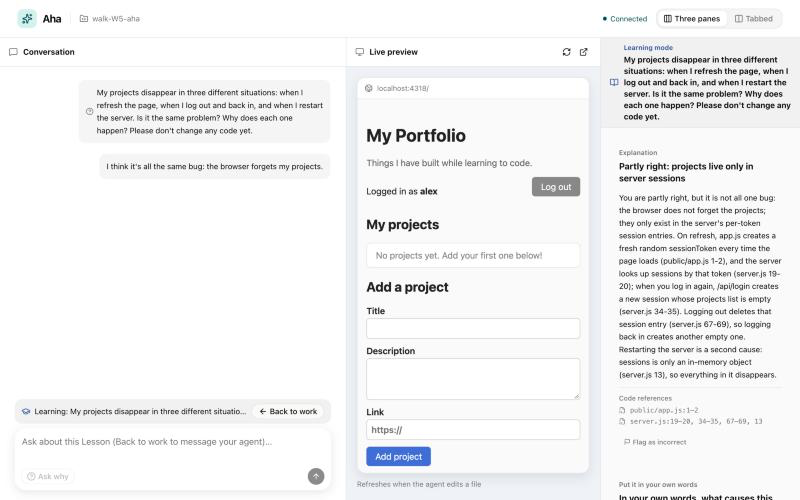
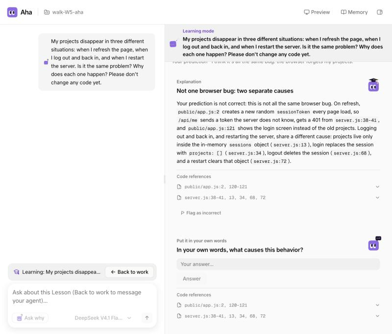
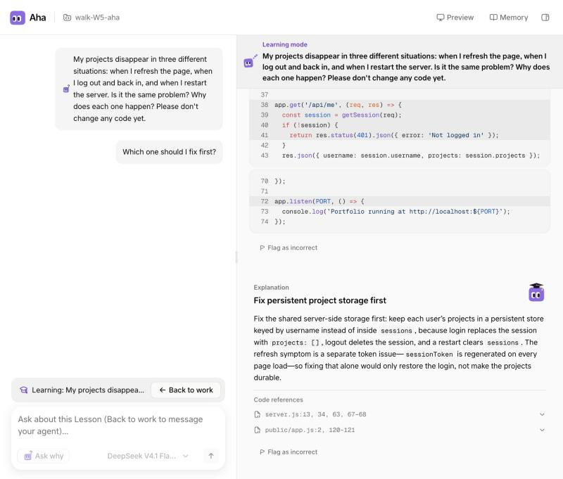

# W5: One question, several causes

Run on 2026-11-27 by BZ, with a Claude Code agent setting up, recording times and drafting the scores. Scenario [#90](https://github.com/Zby9999/aha/issues/90) and evaluation guide [#85](https://github.com/Zby9999/aha/issues/85).

## Setup

| | Aha | Codex |
|---|---|---|
| Version | commit `58e4280` / Pi `1.5.2` | Codex CLI `0.172.0` (`@openai/codex`) |
| Model | `ollama-cloud/deepseek-v4.1-flash`, thinking `high` (Pi's default) | `gpt-6.2-sol` (CLI default, "GPT-6.2-Sol default") |
| Settings | Five real modules, fresh portfolio copy, empty Learner Model, `AHA_DREAM_IDLE_MS=30000` | Interactive TUI, fresh portfolio copy, empty Codex home with only the login file (no `config.toml`, `AGENTS.md` or user skills), default approval and `workspace-write` sandbox, memories off (the default) |
| Run order | 1 | 2 |

BZ played the scripted learner: typed every scripted message and answer in both products and checked every symptom. The agent started Aha, prepared the clean Codex home, read times from Aha's Timeline and Codex's session log, checked the citations and drafted the scores.

The models differ. Pi kept its default DeepSeek model, so the team's Aha runs use one model; Codex used its own default. Some differences below (speed, length, which causes get covered) may come from the model, not only from the product design.

## Scores

| | Aha | Codex |
|---|---|---|
| R1 Timing | 1 | 1 |
| R2 Grounding | 2 | 2 |
| R3 Correctness | 1 | 1 |
| R4 Active learning | 2 | 0 |
| R5 Feedback | 2 | 2 |
| R6 Adaptation | N/A | N/A |
| R7 Work continuity | 2 | 2 |
| R8 Control | 2 | 0 |
| T-explain (s) | 97.7 (9.8 without the 87.9 s the learner spent on the Probe) | 16.5 |
| Length (words) | 88 | 167 |
| Citations correct / cited | 5/5 | 6/6 |
| Learner turns | 4 (2 Probes, 2 Articulations) | 0 |
| Key points covered | K1; K3 and part of K4 only in the follow-up Lesson; not K2 | K1, K2, K3; not K4 |

W5 records:

| | Aha | Codex |
|---|---|---|
| Structure | A title, one summary sentence and a four-step data-flow diagram, all about the refresh case. The other two situations get half a sentence | One summary sentence, then a table with one row per situation, each row with its own code links |
| Missing cause after A2 | Not pointed out. The Lesson ended right after A2 ("Lesson complete. Back to work."); the hidden assessment was `partial`. The restart cause came up only in the next Lesson | Not applicable: Codex asked nothing, so A2 was never given |
| Follow-up gives an order with a reason | No. The answer re-explained the refresh case and said to ask about the restart separately | Yes: "Fix project storage first … That fixes project loss on logout and server restart. Then fix session restoration". Two steps with a reason, in the opposite order to K4 |

## Aha

| Step | What BZ did | What Aha did | Time (Timeline) |
|---|---|---|---|
| 1 | In the Preview tab: logged in, added *Weather app*, refreshed; logged in again; added it, logged out and in; added it, the agent ran `touch server.js`, reloaded and logged in | Logged out after refresh; the list was empty after each of the three situations | before 13:29 |
| 2 | Turned on **Ask why** and sent the big question | Started a Lesson. First card a **Probe** on the refresh case only: "When you reload the browser tab while a project is showing, what do you see on the page a moment later — and what does the server look up to decide that?" | sent 13:29:22.044, Probe 13:29:26.245 (4.2 s) |
| 3a | Answered the Probe with A1 | **Explain** card "A fresh token on every page load, so the server can't find your session" with a data-flow diagram, then an **Articulation** card | answered 13:30:54.106, Explain 13:30:59.702 (5.6 s) |
| 3b | Answered the Articulation with A2 | "Lesson complete. Back to work." No feedback on screen. Timeline `answer_assessment`: `partial` | answered 13:33:24.665, ended 13:33:35.762 |
| 4 | Skipped: A1 had already been given as the Probe answer | | |
| 5 | Turned on **Ask why** again (the Lesson had ended) and sent *Which one should I fix first?* | A second Lesson. Probe: "If you fix just one of the two problems first, what happens the moment you reload the page right after logging in…?" | sent 13:34:55.503, Probe 13:35:02.923 |
| 5a | Answered the Probe with A3 | Explain card "Reload sends a new session token, so the server rejects /api/me", with a data-flow diagram | answered 13:35:33.170, Explain 13:36:01.199 |
| 5b | Answered the Articulation with A3 | Lesson complete, back to work automatically | 13:36:47.722 |
| 6 | Opened the Memory tab and the files under `.aha/learner-model/` | Session file: two weak positive Evidence entries, `client-server` and `shared-state`, "articulate answer assessed as partial". Dreaming (13:34:31): both `not_encountered → correct_with_hints`. `session-tokens`, `data-belongs-to-user` and `database-persistence` stayed `not_encountered` | |

The main answer, the first Explain card (88 words):

> **A fresh token on every page load, so the server can't find your session**
>
> Partly right: the browser really does lose its proof of who it is when you reload, but it isn't one bug — the token is regenerated each load, and your projects only exist inside the server's memory.
>
> Diagram: sessionToken = Math.random()… at script start → api('/api/me') sends X-Session-Token header → getSession looks up sessions[token] — no entry → 401 → .catch(showLogin) → login form, empty project list

Evidence per score:

- **R1 = 1.** Learning support appeared only when asked (Ask why, twice). There were no work turns, so the unprompted case was not tested.
- **R2 = 2.** Cited `public/app.js:1–2` (the `sessionToken` line), `public/app.js:20–27` (`api()` sends `X-Session-Token`), `public/app.js:121` (`api('/api/me').then(showPortfolio).catch(showLogin)`), `server.js:19–21` (`getSession`) and `server.js:38–43` (`/api/me` answers 401). All five checked out in the copy. The follow-up's nine references (including `server.js:12–13`, the `sessions` store, and `public/index.html:17, 33`, the login and portfolio sections) also checked out.
- **R3 = 1.** K1 is covered well, step by step down to the 401. K2 (log in starts an empty session) is never explained, in either Lesson. K3 appears only as "your projects only exist inside the server's memory" in the first card, and as "the separate memory-only session store only matters on a server restart" in the follow-up. That last line is also the only part of K4: it says restart is a separate problem, but not how the token and log-in causes relate. Two of K1–K3 across both Lessons, no false claim.
- **R4 = 2.** Aha asked four times and used A1: the Explain card opens by answering it ("Partly right … but it isn't one bug"). It did not use A2: A2 left out the restart cause and got no reply on screen.
- **R5 = 2.** Corrected the misconception in A1 that the browser holds the projects: "your projects only exist inside the server's memory". The correction is softer than it could be, because it first agrees that "the browser really does lose its proof of who it is".
- **R6 = N/A.** No earlier learning in this scenario. The second Lesson did not refer to the first.
- **R7 = 2.** No work request was made. Each Lesson ended by itself and returned to work mode with zero extra actions; **Back to work** was visible during both Lessons.
- **R8 = 2.** **Back to work** was available at every step, and the Memory tab listed every Learner Model file with an editor and **Save changes**.

Measures:

- **T-explain.** Ask why sent at 13:29:22.044; first explanation text (Explain card) at 13:30:59.702, 97.7 s. Aha puts a Probe first, and 87.9 s of that is BZ reading and answering it; Aha's own time is 9.8 s (4.2 s to the Probe, 5.6 s to the Explain card).
- **Length.** 88 words on the first Explain card (title, summary, diagram labels).
- **Structure.** Split into a summary and diagram steps, but only for one of the three causes.

## Codex

| Step | What BZ did | What Codex did | Time (session log) |
|---|---|---|---|
| 1 | Ran `npm start` in the copy, opened http://localhost:3000: logged in, added *Weather app*, refreshed; logged in again; added it, logged out and in; added it, Ctrl-C and `npm start`, reloaded and logged in | Logged out after refresh; the list was empty after each of the three situations | before 13:45 |
| 2 | Sent the big question | Said it would "keep the investigation read-only", listed and read `server.js`, `app.js`, `README.md`, then answered with a summary and a three-row table. No files changed | sent 13:45:58.1, answer 13:46:14.677 |
| 3 | Nothing to answer: Codex asked no question | | |
| 4 | Sent the wrong summary: *So it's all the same bug: the browser forgets my projects. Right?* | Corrected it, with a bullet per situation | 13:48:07 → 13:48:10 (3.2 s) |
| 5 | Sent *Which one should I fix first?* | "Fix project storage first … Then fix session restoration" | 13:49:19 → 13:49:22 (2.7 s) |
| 6 | Looked for anything about memory | Codex said nothing about remembering; its memories feature was off by default | |

The main answer (code links shown as their labels; 167 words):

> The three symptoms share one design problem. Projects are stored inside the login session, and the server keeps those sessions in memory. Each action affects that session differently. [Project storage]
>
> | Action | What happens to your projects |
> |---|---|
> | Refresh the page | The browser generates a new session token on every page load. `/api/me` receives the new token, can't find a matching session, and the browser shows the login form. The old projects are still in server memory under the old token, which the page no longer uses. [Token creation] · [Session lookup] |
> | Log out and back in | Logout deletes the session and its project list. Logging in again with the same username creates a session with an empty list. [Logout] · [Login] |
> | Restart the server | Stopping the server discards all in-memory sessions and their projects. The new process starts with an empty session store, so even a browser that still has its original token can't recover the list. [Session store] |
>
> This diagnosis comes from tracing the code. No files were changed.

Evidence per score:

- **R1 = 1.** Explanations came only when asked, which is all a general agent does; there were no work turns to interrupt.
- **R2 = 2.** Six links, all checked in the copy: `server.js:63` (`session.projects.push(project)`), `public/app.js:2` (the `sessionToken` line), `server.js:38` (the `/api/me` route), `server.js:67` (`/api/logout`), `server.js:34` (`sessions[token] = { username, projects: [] }`) and `server.js:12` (the comment "Everyone who is logged in right now, looked up by their session token", one line above `const sessions = {}`). All point at the right code; the last lands on the comment rather than the declaration.
- **R3 = 1.** K1: "The browser generates a new session token on every page load. `/api/me` receives the new token, can't find a matching session". K2: "Logging in again with the same username creates a session with an empty list". K3: "Stopping the server discards all in-memory sessions and their projects". K4 is missing: the answer opens with "The three symptoms share one design problem", and the reply to A1 ends "The shared problem is that projects belong to a temporary login session". It never separates the restart cause from the token and ownership cause. No false claim.
- **R4 = 0.** Codex only told. It asked no prediction, explanation or judgment in any of the three replies.
- **R5 = 2.** Corrected A1 directly: "The browser forgets **the session token** on refresh. Your projects are stored on the server, inside that session."
- **R6 = N/A.** No earlier learning in this scenario.
- **R7 = 2.** No work request was made and nothing stood between the learner and the agent.
- **R8 = 0.** There is no learning mode to skip or decline, and nothing about the learner is stored or shown (memories off by default; no learner model).

Measures:

- **T-explain.** 16.5 s from sending (13:45:58.1, the turn start in Codex's session log) to the answer (13:46:14.677). A one-line status message came at 2.8 s; it is not an explanation. The TUI showed "Worked for 16s".
- **Length.** 167 words, counting the link labels and the table header.
- **Structure.** Split by cause: one summary sentence, then one table row per situation.

## Aha after the fixes

The five problems this run found were opened as #93–#97 and fixed in #98. BZ then ran the Aha side of W5 again, the same way, on `main` at `b1e010a` (which includes #98 and the App Shell redesign #99), with the same Pi model, a fresh portfolio copy and an empty Learner Model. Codex was not rerun: nothing changed on its side. These scores sit beside the run above; they do not replace it.

| | Aha before (run above) | Aha after the fixes | Codex |
|---|---|---|---|
| R1 Timing | 1 | 1 | 1 |
| R2 Grounding | 2 | 1 | 2 |
| R3 Correctness | 1 | 2 | 1 |
| R4 Active learning | 2 | 2 | 0 |
| R5 Feedback | 2 | 2 | 2 |
| R7 Work continuity | 2 | 2 | 2 |
| R8 Control | 2 | 2 | 0 |
| T-explain (s) | 97.7 (Aha's own 9.8) | 117.0 (Aha's own 31.4) | 16.5 |
| Length (words) | 88 | 99 | 167 |
| Citations correct / cited | 5/5 | 6/7 | 6/6 |
| Key points covered | K1 | K1, K2, K3, K4 (its own grouping, see R3) | K1, K2, K3 |
| Missing cause after A2 | Not pointed out | Pointed out | Not applicable |
| Follow-up gives an order with a reason | No | Yes | Yes |
| Evidence and mastery after Dreaming | `client-server`, `shared-state` → `correct_with_hints` | `session-tokens` → `seen_explanation` | none |

| Step | What happened after the fixes | Time (Timeline) |
|---|---|---|
| 2 | The Probe asked about all three situations and how they relate: "After you refresh the page, do you expect your projects to still be listed, or to come back empty—and do you think logging out and back in, and restarting the server, would have the same cause?" | sent 15:08:02.731, Probe 15:08:22.067 (19.3 s) |
| 3a | A1 → Explain card "Not one browser bug: two separate causes" (`TextExplanation`, 99 words), covering refresh, log-in and restart | answered 15:09:47.731, Explain 15:09:59.766 (12.0 s) |
| 3b | A2 → assessed `partial`, then a card "Almost: one part is missing": "…but you left out the server restart: projects exist only in the in-memory sessions object, so restarting the server clears them too." The Lesson stayed open | answered 15:10:39.136, card 15:10:52.051 |
| 5 | *Which one should I fix first?*, asked inside the open Lesson → "Fix persistent project storage first … The refresh symptom is a separate token issue … fixing that alone would only restore the login, not make the projects durable." No new Probe | asked 15:11:56.090, answer 15:12:08.733 (12.6 s) |
| 6 | Back to work. Evidence: `session-tokens`, `partial`, weak. Dreaming: `session-tokens: not_encountered → seen_explanation` | 15:14:28 |

Evidence for the scores that changed or need a note:

- **R2 = 1.** Six of seven citations check out (`public/app.js:2`, `120–121`; `server.js:38–41`, `13`, `34`, `68`). The seventh does not: "a restart clears that object (`server.js:72`)" points at `app.listen(PORT, …)`, which clears nothing; the object is created empty at line 13.
- **R3 = 2.** K1, K2 and K3 are all covered with no false claim, and the card says how the causes relate and the follow-up gives an order with a reason, which is what K4 asks for. Its grouping differs from the key's: refresh alone, then "Logging out and back in, and restarting the server, share a different cause: projects live only inside the in-memory `sessions` object", where the key groups refresh with log-in (the token and ownership design) and restart alone (nothing saved to disk). BZ judged Aha's grouping a defensible reading of the code (projects live in the session either way) and scored it 2; a strict reading of the key would give 1. The follow-up also puts storage first, as Codex did.
- **R4 = 2, now complete.** Both answers were used: A1 by the Explain card ("Your prediction is not correct: this is not all the same browser bug"), A2 by the "Almost: one part is missing" card, which names the restart cause A2 left out.
- **T-explain.** 117.0 s from Ask why to the Explain card; 85.7 s of it is BZ answering the Probe, and Aha's own time is 31.4 s (19.3 s to the Probe, 12.0 s to the Explain card). Slower than before (9.8 s) because the Probe now reads all three situations.

What the fixes changed, issue by issue:

| Issue | Before | After |
|---|---|---|
| #93 several causes cut to one | Refresh-only Probe and diagram | Probe on the relation; text card on all three causes |
| #94 no feedback on a partial answer | "Lesson complete. Back to work." | "Almost: one part is missing", naming the restart |
| #97 follow-up starts a new Lesson | New Probe; question unanswered | Direct answer with an order and a reason |
| #96 Evidence on the wrong Concepts | `client-server`, `shared-state` | `session-tokens` |
| #95 one partial answer → `correct_with_hints` | `correct_with_hints` | `seen_explanation` |

New problem found in this run: **the answer to a question typed in the conversation appears only in the Learning panel.** BZ typed *Which one should I fix first?* in the conversation's composer ("Ask about this Lesson…"). The question appeared on the left, but the answer appeared only at the bottom of the Learning panel on the right, with nothing on the left to say an answer had arrived. BZ thought the agent had stopped working. A question asked on the left should be answered on the left, or at least pointed to from there.

## Control: Pi without Aha, same model

Aha and Codex use different models, so the comparison above cannot say how much of a difference comes from the product and how much from the model. To separate them, the agent ran W5 once more in Pi itself, without Aha, on the same model Aha uses (`ollama-cloud/deepseek-v4.1-flash`, thinking `high`, confirmed in Pi's session file). Pi ran like Codex: in print mode (`pi -p`, then `pi -c -p`) in a fresh copy (`/tmp/walk-W5-pi`), with the account owner's extensions, skills, MCP servers and `AGENTS.md` turned off (`--no-extensions --no-skills --no-mcp --no-context-files --no-prompt-templates`). The agent sent the scripted messages; step 1 was not repeated, because Pi does not see the browser and the symptoms were already confirmed in identical copies. Pi changed no code.

| | Aha before | Aha after the fixes | Pi alone (same model) | Codex |
|---|---|---|---|---|
| R2 Grounding | 2 | 1 | 2 | 2 |
| R3 Correctness | 1 | 2 | 2 | 1 |
| R4 Active learning | 2 | 2 | 0 | 0 |
| R5 Feedback | 2 | 2 | 2 | 2 |
| R8 Control | 2 | 2 | 0 | 0 |
| T-explain (s) | 97.7 (Aha's own 9.8) | 117.0 (Aha's own 31.4) | 9.4 | 16.5 |
| Length (words) | 88 | 99 | 408 | 167 |
| Citations correct / cited | 5/5 | 6/7 | 6/6 | 6/6 |
| Missing cause after A2 | Not pointed out | Pointed out | Not applicable | Not applicable |
| Follow-up gives an order with a reason | No | Yes (storage first) | Yes (storage first) | Yes (storage first) |

Pi's answer to the big question opens: "They aren't the same bug, but they all come from the same design decision: **projects live inside a temporary login session**, not in durable per-user storage." It then names "two temporary layers" (the token made fresh in the browser, `public/app.js:2`; the in-memory `sessions`, `server.js:13, 34, 63`), gives one heading per situation with the code line that causes it, and ends with a summary table. All six citations check out (`public/app.js:2`; `server.js:13, 14, 20, 34, 63`). To A1 it said: "The browser never stored your projects in the first place." To the follow-up: "Fix **server-side persistence first**", with three reasons, then the session.

What this shows:

- **The model was not what made Aha's first answer weak.** With the same DeepSeek model, plain Pi covered K1–K3 and how they relate, in 9.4 s. Aha before the fixes covered only K1 (R3 1). The gap came from Aha's Lesson design (#93), which is why the fixes in #98 closed it without changing the model.
- **After the fixes Aha says what Pi says.** Same grouping (refresh on its own; log in and restart through the in-memory session), same order (storage first). What Aha adds is the learning: a Probe before the answer, a correction of A1 and of the cause A2 left out, and Evidence on `session-tokens`. What it costs: the learner works for the answer, and the first explanation is a quarter of Pi's length (99 against 408 words).
- **Codex's tidy, split answer is not an advantage of its model alone.** Pi on DeepSeek also split the answer by situation, with headings and a table. And Codex's R3 of 1 is no better than Pi's 2, so the Aha–Codex difference in content is not explained by the model either.
- **Plain Pi and Codex behave alike as general agents:** fast, complete, structured, and they only tell (R4 0, R8 0).

## Differences that matter

1. **Codex covered all three causes; Aha covered one.** Codex's table explains refresh, log-in and restart, each with code links. Aha's first Explain card explains refresh in a four-step diagram and gives the rest half a sentence ("your projects only exist inside the server's memory"); log-in (K2) is never explained. This is where Aha does worse in this run. Both get R3 = 1, but for different reasons: Codex misses only K4, Aha misses K2 and most of K4.
2. **Aha's Probe narrowed a three-part question to one part.** The learner asked about three situations; the Probe asked only "When you reload the browser tab…", and the Explain card followed the Probe. The earlier run showed the same Probe but an Explain card that covered all three causes (see Deviations), so the narrowing is not fixed behaviour, but the Lesson design (one Probe, one Explain card) gives a multi-cause question little room.
3. **Aha made the learner think, but dropped the answer that mattered.** Aha asked four times (R4 2 vs 0) and its first card answered A1. After A2, which left out the restart cause, Aha said only "Lesson complete. Back to work." and stored a `partial` assessment as weak Evidence for `client-server` and `shared-state`. Dreaming then moved both to `correct_with_hints`, while `session-tokens` and `data-belongs-to-user`, the concepts this scenario is about, stayed `not_encountered`. Codex never asked, so it had no answer to use or misuse.
4. **On "which first", only Codex answered.** Codex gave two steps and a reason: storage first, because "that fixes project loss on logout and server restart", then session restoration. Its order is the opposite of the key's, but it is a defensible plan. Aha started a new Lesson, re-explained the refresh case, and said "the separate memory-only session store only matters on a server restart, so ask about that with Ask why": the closest it came to K4, but not an order.
5. **Both corrected A1 and grounded every claim (R5 2 and 2, R2 2 and 2), and Aha's machine time was short.** All 5 of Aha's and all 6 of Codex's citations checked out. Aha's own time to the Explain card was 9.8 s against Codex's 16.5 s, but the Probe in front of it cost the learner 87.9 s, so the learner waited 97.7 s for the first explanation.

## Deviations

- **Two runs.** An earlier, agent-driven run on the same day (the agent typed the scripted messages, and Codex was driven with `codex exec`) was replaced by this run, which BZ drove by hand, so the scores rest on a human-driven run. Nothing crashed in the earlier run. Its results differed on Aha's main answer: the Explain card that time covered K1, K2 and K3 in one 114-word paragraph and said "it is not all one bug … Restarting the server is a second cause" (R3 2), and the follow-up gave an order ("start by making the session token stable"). Everything else matched this run: the same refresh-only Probe, no feedback on A2, the same `partial` assessment and the same two concepts in the Learner Model; Codex's answers were nearly word for word the same. The two Aha runs together show that the coverage of a multi-cause question varies from run to run with the same model.
- **Codex home.** Codex ran with an empty home folder holding only the login file. With only `CODEX_HOME` emptied, the earlier run showed Codex still loading the account owner's personal skills from `~/.agents/skills`, which would break the "default settings, no custom instructions" rule.
- **Models differ** (see Setup).
- Aha's Probe asked a prediction, so A1 went there; step 4 (send A1 as a message) was not needed in Aha. In Codex it was sent as a message.
- In Aha, step 5 was sent with **Ask why** on because the first Lesson had already ended. It started a second Lesson with its own Probe and Articulation, answered with A3.
- In Aha, the restart in step 1 was triggered by the agent running `touch server.js` in the copy while BZ worked in the Preview tab.
- Neither product changed any code. Both copies were compared with `examples/portfolio` afterwards: no differences.
- **After-the-fixes run restarted once.** In its first attempt the Articulation was answered with A1 instead of A2, so the "missing cause" check could not be made. Aha was restarted with a fresh copy and an empty Learner Model and the run was repeated from step 1; the section above reports the repeat. The first attempt's Probe and Explain card already showed the fix: a Probe on whether the three situations share a cause, and a card titled "Not one bug — three separate causes" covering K1–K3.
- In the after-the-fixes run, step 5 was asked inside the still-open Lesson (the "Almost" card keeps the Lesson open), as the script says, rather than with Ask why after the Lesson ended.
